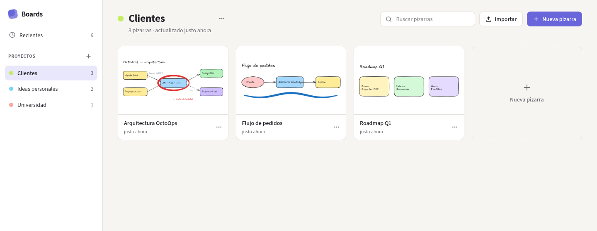
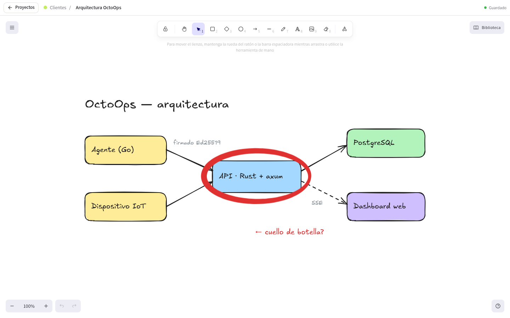
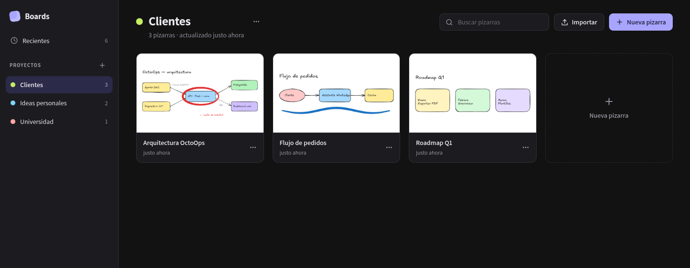
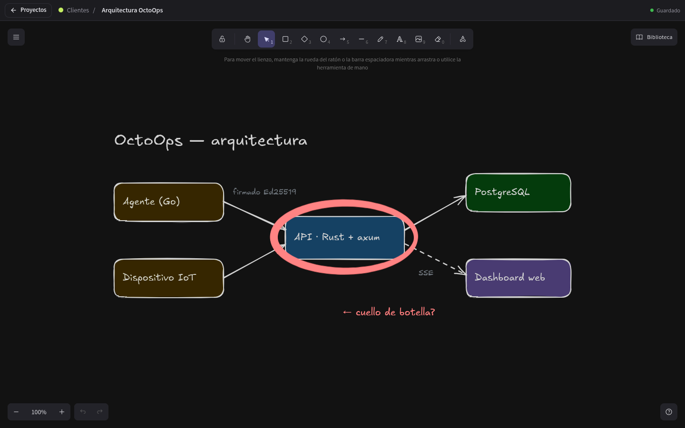

# Boards

[English](README.md) · **Español**

App de escritorio para organizar pizarras en proyectos, construida sobre el motor de dibujo
de [Excalidraw](https://github.com/excalidraw/excalidraw) y Electron. Todo se queda en tu
equipo como archivos `.excalidraw` estándar.





<details>
<summary>Tema oscuro</summary>




</details>

## Funciones

- **Proyectos y pizarras**: proyectos con color, miniaturas, búsqueda y vista de recientes.
- Renombrar, duplicar, mover entre proyectos, eliminar, e importar o exportar archivos `.excalidraw`.
- **Autoguardado** en archivos locales; también guarda al volver a la lista y al cerrar la ventana.
- **Funciona sin conexión**: las fuentes de Excalidraw van incluidas en la app en vez de cargarse desde un CDN.
- **Presión del lápiz**: Chromium entrega a Excalidraw la presión real de la tableta
  (`PointerEvent.pressure`), así que los trazos a mano alzada varían de grosor. En cuanto usas
  un lápiz aparece un medidor de presión en vivo en la barra superior del editor.
- Menú de Excalidraw reducido: sin colaboración, sin «abrir archivo» ni «guardar como».
- Tema claro, oscuro o del sistema.

Por ahora la interfaz está en español. Las traducciones son una contribución bienvenida.

## Estado del proyecto

Es una base funcional pensada para que otros la forkeen y la extiendan. Está compilada y
probada en **Linux** (Arch, Wayland/niri). Electron también funciona en Windows y macOS, pero
la configuración de build y las pruebas por ahora cubren solo Linux.

## Primeros pasos

Requiere Node ≥ 20.19 y [pnpm](https://pnpm.io) (`corepack enable`).

```bash
pnpm install
pnpm dev            # ejecutar con recarga en caliente
pnpm typecheck
```

### Compilar

```bash
pnpm dist           # AppImage + paquete pacman en dist/
pnpm dist:dir       # solo la carpeta desempaquetada (más rápido)
pnpm install:local  # compilar e instalar para tu usuario (Linux, sin root)
```

`install:local` copia la app a `~/.local/opt/boards` y crea el comando `boards`
(`~/.local/bin`), la entrada `boards.desktop` y los íconos en `~/.local/share`. La ventana se
identifica como `boards` (app_id en Wayland, WM_CLASS en X11), así que barras de tareas y
lanzadores la asocian con su ícono. Vuelve a ejecutarlo después de cada cambio.

## Dónde se guardan tus datos

Todo vive en `~/.config/Boards/workspace/` (el botón «Carpeta de datos» la abre):

```
workspace.json             índice de proyectos y pizarras
boards/<id>.excalidraw     escenas en formato estándar de Excalidraw
thumbnails/<id>.png        miniaturas
library.excalidrawlib      biblioteca de formas
```

Los archivos de pizarra se abren tal cual en [excalidraw.com](https://excalidraw.com).

## Presión del lápiz en Wayland

Electron corre nativo en Wayland, donde la presión depende de que el compositor soporte el
protocolo de tabletas. Si el medidor de presión no aparece o se queda quieto, ejecuta la app
sobre XWayland, donde la presión pasa por XInput2:

```bash
BOARDS_FORCE_X11=1 boards   # app instalada
pnpm dev:x11                # en desarrollo
```

## Personalizar

El código propio de la app es pequeño (~1.700 líneas de TypeScript). Buenos puntos de partida:

| Si quieres… | Mira |
| --- | --- |
| Mostrar u ocultar funciones y opciones de menú de Excalidraw | `UIOptions` y `<MainMenu>` en `src/renderer/src/components/BoardEditor.tsx` |
| Cambiar el autoguardado o las miniaturas | `save` / `handleChange` en `BoardEditor.tsx` |
| Cambiar cómo se guardan proyectos y pizarras | `src/main/store.ts` |
| Agregar una operación que la interfaz pueda llamar | `BoardsApi` en `src/shared/types.ts`, luego `src/preload/index.ts` y `registerIpc()` en `src/main/index.ts` |
| Cambiar el estilo del gestor de proyectos | `src/renderer/src/styles.css` (variables CSS al inicio) |

```
src/main/        proceso principal: ventana, protocolo app://, IPC, almacenamiento
src/preload/     puente seguro (contextBridge) expuesto como window.boards
src/renderer/    React: gestor de proyectos y editor
src/shared/      tipos compartidos
resources/       ícono de la app (icon.svg es el original)
scripts/         copia de fuentes, generación de licencias, instalación local
```

La interfaz se sirve desde un protocolo propio `app://`, con una Content Security Policy
estricta en los builds de producción. El renderer corre en sandbox con aislamiento de
contexto, y los enlaces se abren en el navegador del sistema.

Para regenerar los PNG del ícono después de editar `resources/icon.svg`:

```bash
for n in 16 24 32 48 64 128 256 512; do rsvg-convert -w $n -h $n resources/icon.svg -o resources/icons/${n}x${n}.png; done
cp resources/icons/512x512.png resources/icon.png
```

## Licencia

[MIT](LICENSE). Boards es un proyecto independiente, sin relación con Excalidraw.
El código y las fuentes de terceros se acreditan en [THIRD_PARTY_NOTICES.md](THIRD_PARTY_NOTICES.md);
los textos completos de licencia de cada librería incluida están en
[THIRD_PARTY_LICENSES.txt](THIRD_PARTY_LICENSES.txt), que se regenera en cada build.
