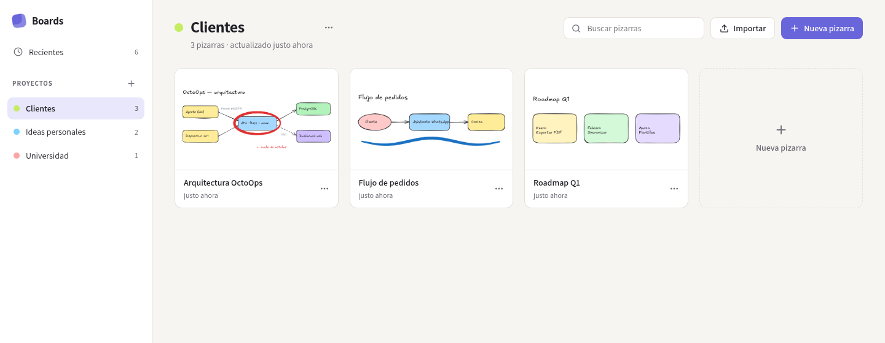
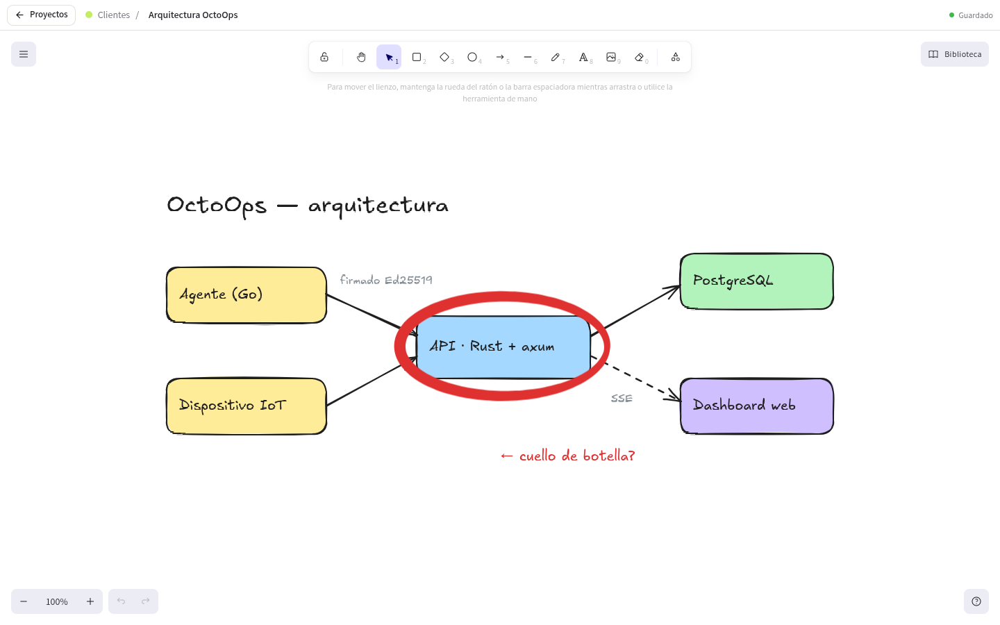
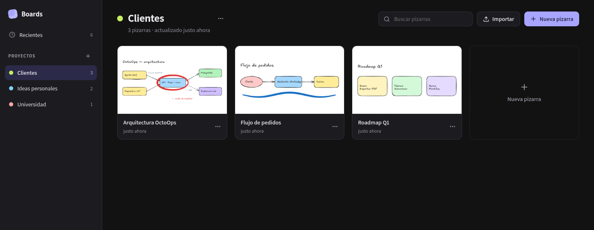
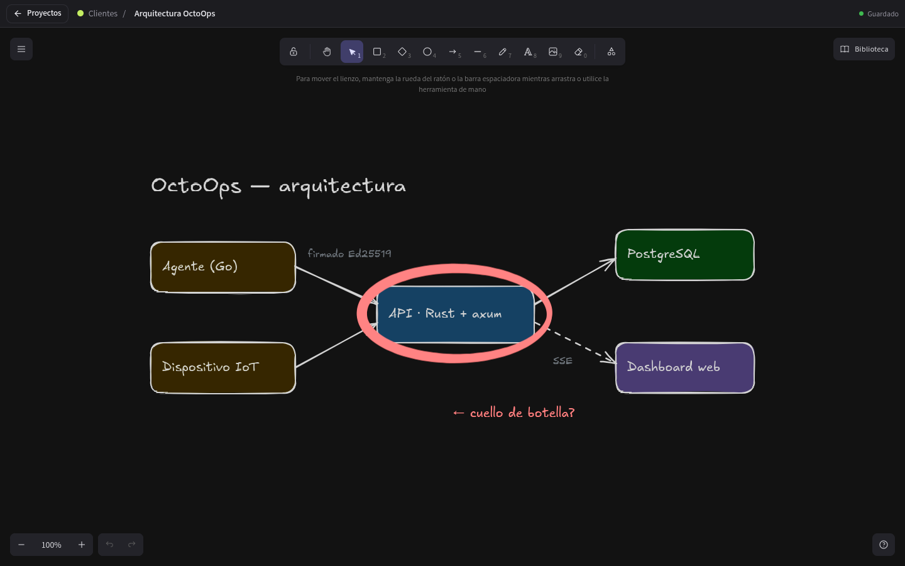

# Boards — Gestor de proyectos y pizarras

> **Rama `Manager`:** Esta rama contiene el gestor de proyectos y pizarras de escritorio construido con **Electron**, **React** y el motor de dibujo de [Excalidraw](https://github.com/excalidraw/excalidraw) (`@excalidraw/excalidraw`). A diferencia de la rama `native-engine` (que implementa un motor vectorial nativo en Rust sin Chromium), aquí el foco está en la **organización por proyectos, gestión local de archivos `.excalidraw`, miniaturas, autoguardado y flujo de escritorio completo**.

## Capturas

### Gestor de proyectos (tema claro)


### Editor de pizarras (tema claro)


<details>
<summary>Capturas en tema oscuro</summary>




</details>

## Arquitectura

El código propio de la aplicación (~1.675 líneas de TypeScript) se divide en proceso principal, puente seguro (`preload`), interfaz en React y tipos compartidos:

```text
.
├── electron.vite.config.ts
├── package.json
├── scripts/
│   ├── copy-fonts.mjs             # Copia fuentes locales de Excalidraw para uso sin conexión
│   ├── generate-licenses.mjs      # Genera THIRD_PARTY_LICENSES.txt en cada build
│   └── install-local.sh           # Instala la app compilada para el usuario actual en Linux
├── resources/
│   ├── icon.svg                   # Ícono fuente
│   └── icons/                     # PNGs en múltiples resoluciones (16x16 a 512x512)
└── src/
    ├── shared/
    │   └── types.ts               # Modelos Project, Board, Workspace y contrato BoardsApi
    ├── preload/
    │   └── index.ts               # Expone window.boards vía contextBridge (sin Node en renderer)
    ├── main/
    │   ├── index.ts               # Ventana, protocolo app://, bloqueo de CDN, IPC y flush al cerrar
    │   └── store.ts               # WorkspaceStore: índice JSON atómico, escenas y miniaturas
    └── renderer/
        ├── index.html
        └── src/
            ├── App.tsx            # Alterna entre ProjectManager y BoardEditor, y gestiona el tema
            ├── theme.ts           # Preferencia de tema (claro, oscuro o sistema)
            ├── format.ts          # Utilidades de formato y tiempo relativo
            ├── styles.css         # Estilos del gestor y variables CSS
            └── components/
                ├── ProjectManager.tsx  # Barra lateral de proyectos, recientes, búsqueda y tarjetas
                ├── BoardEditor.tsx     # Wrapper de Excalidraw, autoguardado, miniaturas y menú
                ├── PenStatus.tsx       # Medidor en vivo de presión del lápiz (PointerEvent.pressure)
                ├── Dialogs.tsx         # Diálogos modales de creación, renombrado, color y confirmación
                └── Menu.tsx            # Menú contextual para proyectos y pizarras
```

## Cómo funciona el gestor

### 1. Organización por proyectos y pizarras
- **Proyectos con color:** cada proyecto agrupa pizarras y tiene un color identificativo configurable desde una paleta predefinida. Puedes crear, renombrar, cambiar de color y eliminar proyectos.
- **Vista de recientes:** muestra hasta las **24 pizarras** modificadas más recientemente entre todos los proyectos, ordenadas por `updatedAt`.
- **Búsqueda instantánea:** filtra pizarras por nombre dentro del proyecto seleccionado o en la vista de recientes.
- **Acciones sobre pizarras:** crear, abrir, renombrar, duplicar (copiando escena y miniatura), mover entre proyectos y eliminar.
- **Importar y exportar `.excalidraw`:** importa uno o varios archivos `.excalidraw` hacia un proyecto o exporta cualquier pizarra al disco con diálogo nativo.

### 2. Almacenamiento local (`WorkspaceStore`)
Toda la información se guarda en el directorio de datos de usuario (`~/.config/Boards/workspace/` en Linux), accesible directamente desde el botón **«Carpeta de datos»**:

```text
workspace.json             # Índice con proyectos, colores, fechas y lista de pizarras
boards/<id>.excalidraw     # Escenas en formato estándar de Excalidraw
thumbnails/<id>.png        # Miniaturas PNG para las tarjetas del gestor
library.excalidrawlib      # Biblioteca de formas compartida entre pizarras
```

- **Escrituras atómicas y serializadas:** `WorkspaceStore` encadena las mutaciones en una cola interna y escribe `workspace.json` mediante archivos temporales + `rename` para evitar corrupción ante cierres inesperados. Si el índice estuviera dañado, conserva una copia `.corrupt-<timestamp>` antes de regenerarlo.
- **Compatibilidad total:** cualquier archivo en `boards/<id>.excalidraw` se puede abrir directamente en [excalidraw.com](https://excalidraw.com) o en el motor nativo de la rama `native-engine`.

### 3. Editor integrado, autoguardado y miniaturas
- **Autoguardado continuo:** `BoardEditor` serializa la escena (`serializeAsJSON`) con un *debounce* de **700 ms** tras cada cambio, y fuerza el guardado al volver al gestor o al cerrar la ventana (el proceso principal envía `app:flush` y espera hasta `3000 ms` la confirmación `app:flushed`).
- **Miniaturas automáticas:** exporta vistas previas PNG (`maxWidthOrHeight: 640`) cada **5 segundos** durante la edición y al cerrar la pizarra; si el lienzo queda vacío, elimina la miniatura anterior.
- **Menú adaptado:** oculta opciones que no aplican al flujo del gestor (colaboración, «abrir archivo» o «guardar como» desde el menú de Excalidraw) y añade botón de regreso al gestor y exportación rápida.
- **Biblioteca compartida:** los elementos guardados en la biblioteca de Excalidraw se persisten en `library.excalidrawlib` y están disponibles en todas las pizarras.

### 4. Funcionamiento sin conexión y seguridad
- **Protocolo `app://` y bloqueo de CDN:** la interfaz se sirve desde `app://boards/index.html` con aislamiento de contexto (`contextIsolation: true`, `sandbox: true`, `nodeIntegration: false`). Las fuentes de Excalidraw se copian al paquete con `scripts/copy-fonts.mjs` y cualquier petición a `https://esm.sh/*` es cancelada en `main`.
- **Enlaces externos:** los enlaces dentro de las pizarras se abren en el navegador del sistema y nunca navegan dentro de la ventana de la app.

### 5. Presión del lápiz y tema
- **Presión de tableta:** Chromium pasa `PointerEvent.pressure` a Excalidraw para variar el grosor en trazos a mano alzada; `PenStatus` muestra un indicador en vivo en la barra superior en cuanto detecta un lápiz.
- **Wayland / XWayland:** en Linux corre nativo en Wayland; si el compositor no entrega presión de tableta, puede forzarse XWayland con `BOARDS_FORCE_X11=1`.
- **Tema:** configurable entre claro, oscuro o seguir al sistema.

## Requisitos, desarrollo y compilación

Requiere **Node ≥ 20.19** y **pnpm** (`corepack enable`).

```bash
# Instalar dependencias
pnpm install

# Ejecutar en modo desarrollo (copia fuentes + electron-vite dev)
pnpm dev

# Ejecutar en desarrollo forzando X11/XWayland (útil para presión de lápiz)
pnpm dev:x11

# Verificar tipos TypeScript
pnpm typecheck
```

### Empaquetado e instalación local (Linux)

```bash
# Generar AppImage y paquete pacman en dist/
pnpm dist

# Generar solo la carpeta desempaquetada (más rápido)
pnpm dist:dir

# Compilar e instalar para el usuario actual (~/.local/opt/boards y comando `boards`)
pnpm install:local
```

`install:local` instala el binario en `~/.local/opt/boards`, crea el lanzador `~/.local/bin/boards`, registra `boards.desktop` (`StartupWMClass=boards`) y copia los íconos en `~/.local/share`.

## Licencia

[MIT](LICENSE). Boards es un proyecto independiente y no está afiliado a Excalidraw. Las atribuciones y licencias de terceros se incluyen en [THIRD_PARTY_NOTICES.md](THIRD_PARTY_NOTICES.md) y [THIRD_PARTY_LICENSES.txt](THIRD_PARTY_LICENSES.txt).
