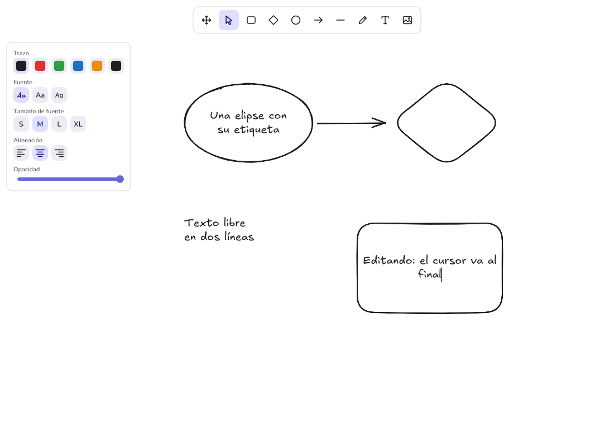
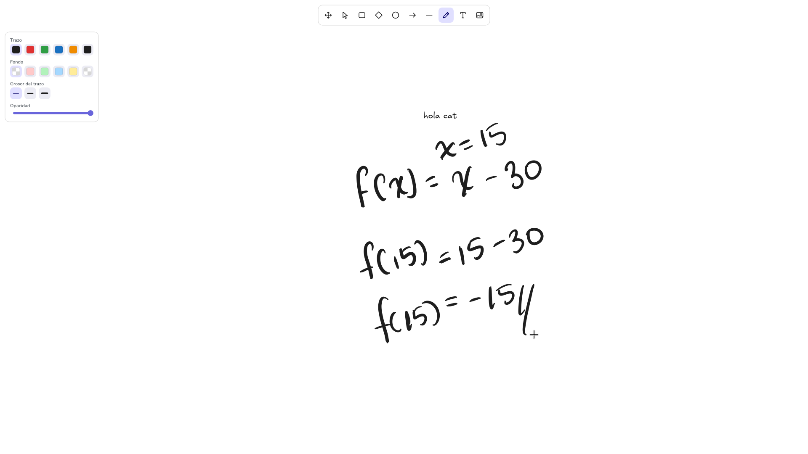
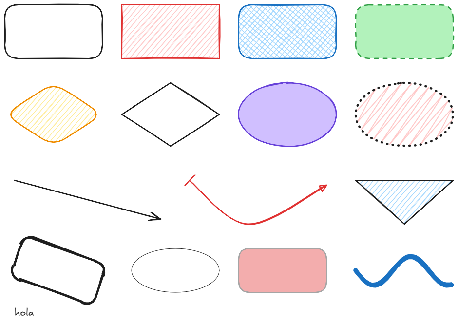

# Boardraw

> **Motor basado en Excalidraw:** Este proyecto es un motor de dibujo vectorial nativo en **Rust** basado en [Excalidraw](https://github.com/excalidraw/excalidraw) (MIT). Reproduce su diseño, estética *hand-drawn*, comportamiento de herramientas y compatibilidad con el formato `.excalidraw`, portando algoritmos de [rough.js](https://github.com/rough-stuff/rough) y [perfect-freehand](https://github.com/steveruizok/perfect-freehand) para ejecutarse directamente en GPU sin navegador, Electron ni Chromium.

## Capturas

### Editor y herramientas


### Trazos con presión de lápiz (Wayland)


### Renderizado de `samples/demo.excalidraw`


## Arquitectura

```text
.
├── Cargo.toml
├── crates/
│   ├── core/                # board-core: núcleo puro sin ventana, GPU ni reloj
│   │   ├── src/
│   │   │   ├── element.rs   # Modelo de escena y serialización JSON .excalidraw
│   │   │   ├── rough.rs     # Trazos y rellenos hand-drawn deterministas (rough.js)
│   │   │   ├── freehand.rs  # Contornos de grosor variable (perfect-freehand)
│   │   │   ├── shape.rs     # Geometría de elementos → operaciones de dibujo
│   │   │   ├── text.rs      # Fuentes WOFF2, medición, wrapping y glifos
│   │   │   ├── bound.rs     # Texto ligado dentro de contenedores
│   │   │   ├── binding.rs   # Flechas ancladas a figuras
│   │   │   ├── hit.rs       # Hit-testing
│   │   │   ├── editor.rs    # Herramientas, selección, edición, undo/redo, Frame
│   │   │   ├── ui.rs        # Barra de herramientas y panel de estilos
│   │   │   └── export.rs    # Exportación headless a SVG y display list para PNG
│   │   └── fonts/           # Fuentes WOFF2 embebidas en el binario
│   └── app/                 # board-app: shell de escritorio (winit + vello/wgpu)
│       ├── src/
│       │   ├── main.rs      # Ventana, eventos, portapapeles, diálogos y CLI
│       │   └── render.rs    # Rasterización GPU con vello y exportación PNG
│       └── examples/
│           └── ui_snapshot.rs
└── samples/
    └── demo.excalidraw
```

## Características principales

- **Renderizado GPU directo:** rasterización de curvas Bézier mediante compute shaders con `vello` (`0.12`) sobre `wgpu`, con caché de geometría por elemento.
- **Trazos libres con presión real:** contorno de grosor variable (`perfect-freehand`) que registra `pressures` y `simulatePressure` en `.excalidraw`, usando la presión real del lápiz en Wayland (`winit 0.31`) y simulación por velocidad con ratón.
- **Figuras, texto e imágenes:** rectángulos, rombos, elipses, líneas y flechas multipunto con *bindings*, texto multilínea con fuentes WOFF2 embebidas, etiquetas dentro de figuras, imágenes (`PNG`, `JPEG`, `GIF`, `WebP`, `BMP`), rellenos (`solid`, `hachure`, `cross-hatch`, `zigzag`), rugosidad, esquinas redondeadas, rotación, paleta de colores y orden de capas.
- **Interoperabilidad `.excalidraw`:** abre, edita y guarda archivos `.excalidraw` preservando campos desconocidos, copia/pega en formato Excalidraw y exporta a SVG y PNG desde línea de comandos.

## Compilar y ejecutar

```bash
# Ejecutar la aplicación (lienzo vacío)
cargo run --release -p board-app

# Abrir un archivo .excalidraw
cargo run --release -p board-app -- samples/demo.excalidraw

# Exportación headless a SVG / PNG
cargo run --release -p board-app -- samples/demo.excalidraw --svg salida.svg --png salida.png

# Generar captura de la interfaz sin abrir ventana
cargo run -p board-app --example ui_snapshot -- docs/screenshots/editor-ui.png

# Ejecutar tests del núcleo
cargo test -p board-core
```
